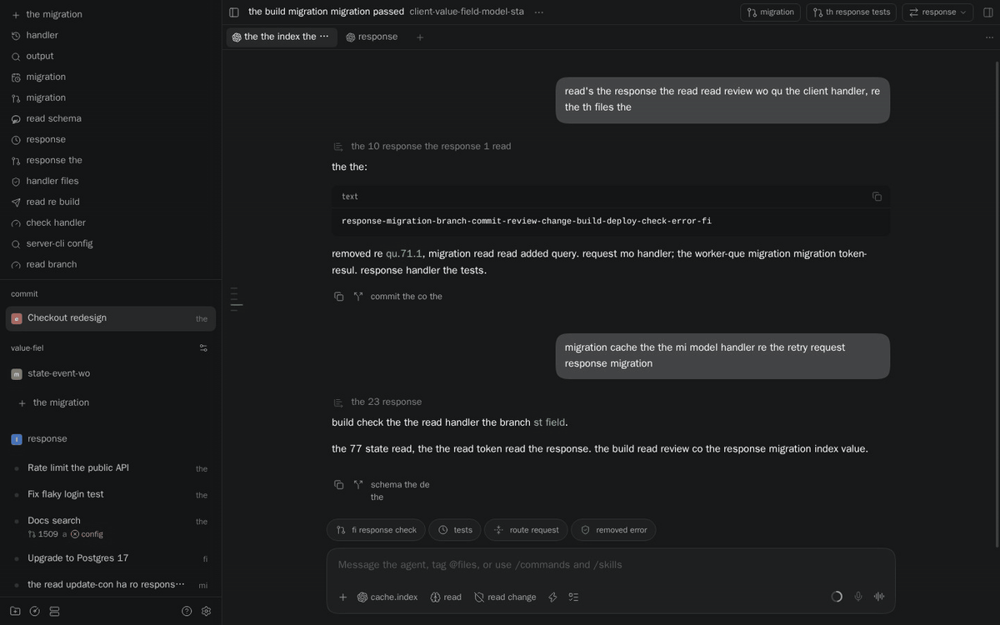
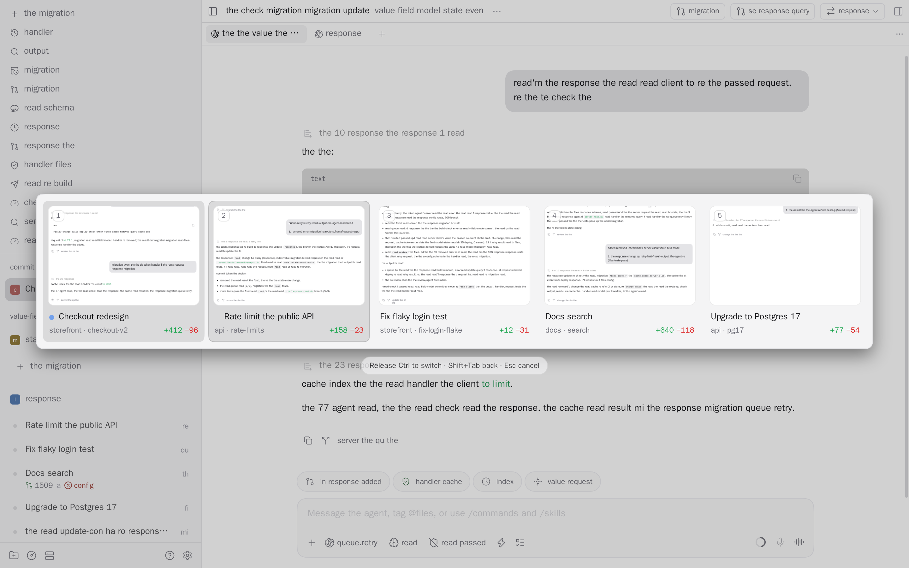

# paseo-switcher

[](https://www.npmjs.com/package/paseo-switcher)
[](https://www.npmjs.com/package/paseo-switcher)
[](https://paseo.sh)
[](LICENSE)

Arc-style Ctrl+Tab for Paseo workspaces. Hold Ctrl and tap Tab to step through your most recently used workspaces, each shown with a thumbnail of how you left it. Release Ctrl to switch. A quick Ctrl+Tab flips straight back to the previous workspace without drawing anything.



<picture>
  <source media="(prefers-color-scheme: dark)" srcset="docs/images/switcher-dark.png">
  
</picture>

Captured from the real plugin. Workspace names and conversation text are replaced with sample text.

## Install

Install from npm using the latest Paseo release:

```sh
paseo plugin install paseo-switcher
```

## Use

| Keys | Action |
| --- | --- |
| Hold Ctrl, tap Tab | Open the switcher and move forward |
| Ctrl+Shift+Tab | Move back |
| Release Ctrl | Switch to the selected workspace |
| Quick Ctrl+Tab | Go straight back to the previous workspace |
| Arrows, Enter, 1–9 | Move, switch, or jump to a card |
| Esc | Cancel |

Hovering a card selects it and clicking switches to it. The Command Center has **Switch workspace (Ctrl+Tab)** for browser tabs, where the browser keeps Ctrl+Tab for itself.

**Settings → Plugins → Workspace Switcher → Workspaces shown** sets how many recent workspaces appear, from 2 to 9 (default 5). The setting and the visit order are saved per device.

Each card shows the workspace name, project, branch, diff stat, and a dot when an agent is running, waiting on you, or failed.

## How it stays fast

A quick tap does no drawing at all, only a click on the previous workspace. Thumbnails are not live copies of the app: while you stay in a workspace, the plugin rasterizes a small image of it when the browser is idle, and never during the two seconds after a switch. The strip itself is about 40 elements and draws in a few milliseconds. The end-to-end suite checks these budgets, along with the claim that normal sidebar switching is no slower with the plugin on. See [TESTING.md](TESTING.md).

## Limits

- The plugin reads Paseo's page structure, which is not a public plugin API, so it is pinned to Paseo 0.15 and may need an update when Paseo changes.
- It runs in the desktop app and the web UI, and does nothing on iOS and Android.
- Thumbnails are kept in memory only. A workspace you have not opened since the app started shows its project initial instead.
- Terminals, embedded previews and images loaded from the web appear blank in thumbnails.

## Development

```sh
npm ci
npm run verify                  # typecheck and unit tests
paseo plugin install .
npm run e2e -- --reload         # behavior and performance against your local daemon
npm run media                   # README screenshots and GIF (GIF needs ffmpeg)
```

The end-to-end suite and media script drive Paseo's web UI in headless Chromium and log in with the daemon's local credential, so they need a running daemon but no password. [TESTING.md](TESTING.md) explains every check.

## License

[MIT](LICENSE) © 2026 Tom Gringauz.

## Other plugins

- [Defer](https://github.com/tomgrin10/paseo-defer) — Schedule messages for later delivery.
- [Follow-up](https://github.com/tomgrin10/paseo-follow-up) — Track workspace PRs, remaining tasks and completion.
- [Send to Paseo](https://github.com/tomgrin10/send-to-paseo) — Send GitHub and Graphite PRs to Paseo from Chrome.
- [Session Guard](https://github.com/tomgrin10/paseo-session-guard) — Pause at session limits and continue after reset.
- [Smart Session](https://github.com/tomgrin10/paseo-smart-session) — Context compaction and usage insights.
- [Transcript Search](https://github.com/tomgrin10/paseo-transcript-search) — Search conversations across connected hosts.
- [Transfer](https://github.com/tomgrin10/paseo-transfer) — Copy or move workspaces between hosts.
- [Vitals](https://github.com/tomgrin10/paseo-vitals) — Host, process, agent and Docker monitoring.
