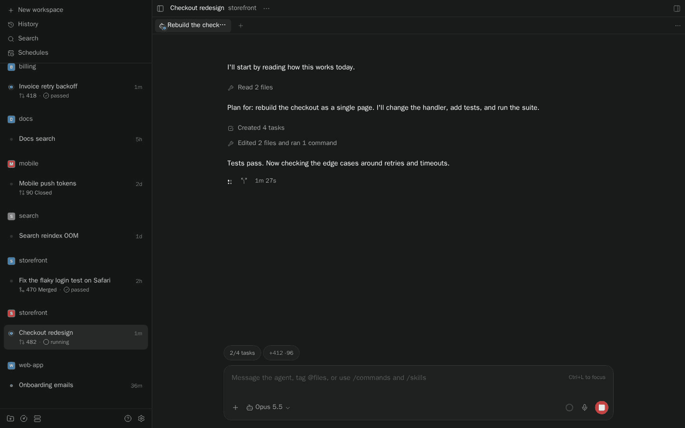
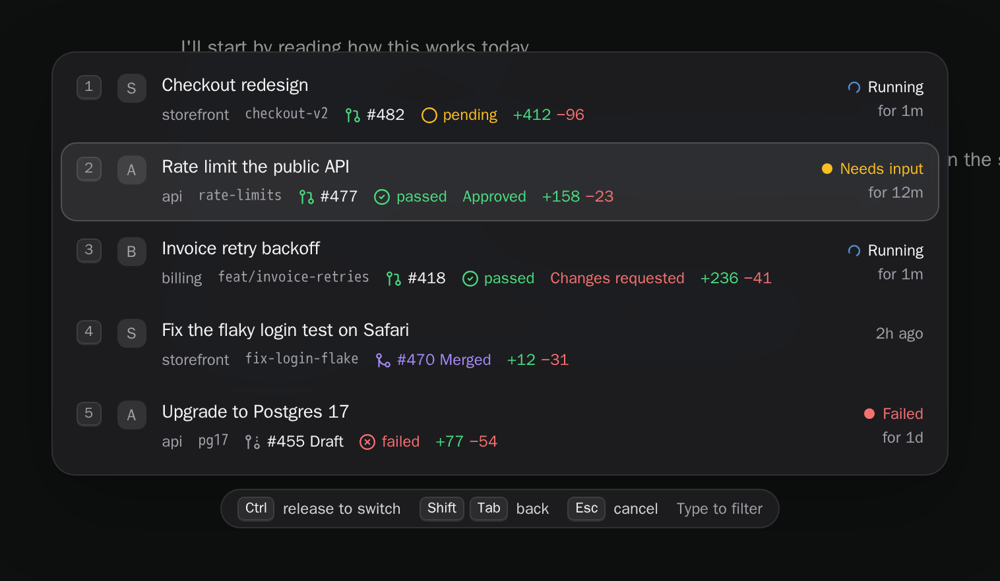
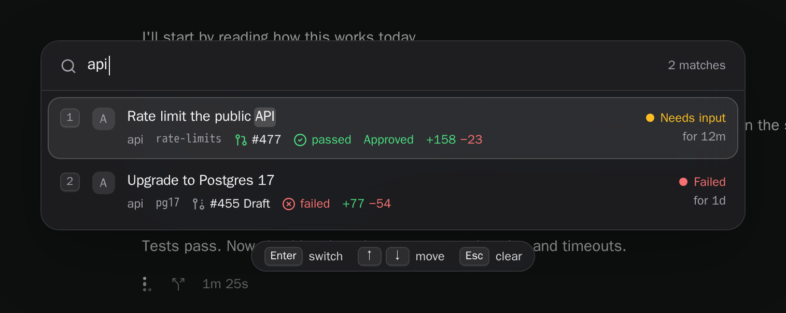
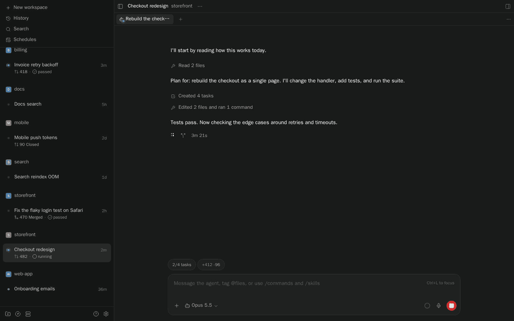
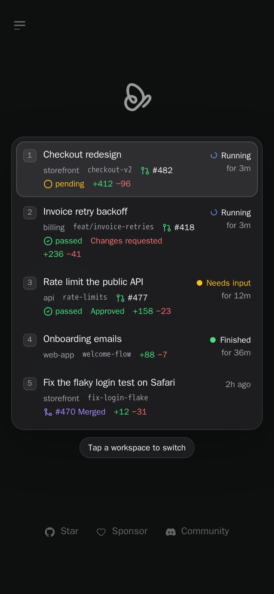

# paseo-switcher

[](https://www.npmjs.com/package/paseo-switcher)
[](https://www.npmjs.com/package/paseo-switcher)
[](https://paseo.sh)
[](LICENSE)

Arc-style workspace switching for Paseo, on Cmd+` by default (Ctrl+Tab, Option+Tab and Ctrl+` are in Settings). Hold Cmd and tap ` to step through your most recently used workspaces, release Cmd to switch. On macOS, first turn off "Move focus to next window" (System Settings → Keyboard → Keyboard Shortcuts → Keyboard), which otherwise keeps Cmd+` for itself. A quick tap flips straight back to the previous workspace without drawing anything. Start typing while it is open to find any workspace by name, project, branch or pull request number.



Each row shows the full workspace name, pull request with its checks, unpushed commits, and what the agent is doing and for how long. Rows follow the sidebar's Display settings: the title or branch as the name, project, branch and host when the sidebar shows them, checks as icon and text or icon only, and the time or the diff stat at the end:

<picture>
  <source media="(prefers-color-scheme: light)" srcset="docs/media/switcher-list-light.png">
  
</picture>

Typing filters every workspace, not only the recent ones, and marks what matched:



Or choose the **Thumbnails** layout for a row of previews of how you left each workspace:



Recorded from the real plugin against a test daemon with sample workspaces; pull request details are sample data.

## Install

Install from npm using the latest Paseo release:

```sh
paseo plugin install paseo-switcher
```

## Use

| Keys | Action |
| --- | --- |
| Hold Cmd, tap ` | Open the switcher and move forward |
| Cmd+Shift+` | Move back |
| Release Cmd | Switch to the selected workspace |
| Quick Cmd+` | Go straight back to the previous workspace |
| Arrows, Enter | Move and switch |
| → (↓ in Thumbnails) | Show the selected workspace's chats; move, then release Cmd or press Enter to open one |
| ← | Back from the chats to the workspaces |
| Type | Filter all workspaces (or, in a workspace's chats, its chat titles); the switcher then stays open until Enter or a click |
| ⌫ | Archive the selected workspace in Paseo: the first press marks it red, a second ⌫ archives it (this removes a worktree workspace's folder). On a plugin screen it hides the screen instead. In a workspace's chats it archives the selected chat; a running or waiting chat needs the second ⌫ too |
| ⇧⌫ | Hide the selected workspace or plugin screen from the switcher (the × on a hovered row does the same) |
| Esc | Clear the filter, then cancel |

With text typed, ⌫ erases it (Ctrl or Option+⌫ clears it all). Moving, typing, any other key, or four seconds cancels a marked row. Holding ⌫ never archives: only a fresh press does, and one within a quarter second of the first is ignored. After archiving or hiding, the switcher waits for Enter or a click instead of switching when you release Cmd. If Paseo cannot archive, the row stays and the hint says why. The × on a hovered chat archives it with the same rule.

A workspace's chats are listed with the one you last had open there first, then by last change, with chats a routine or bot started after yours. Each shows its title and its status, in the words Paseo's sidebar uses. Only chats are listed: Paseo cannot open a terminal tab from a link. The chats come from the host's 200 most recently changed; when it has more, the header says "recent chats", as a workspace's oldest ones may be missing.

The keys above are for the default shortcut, **Cmd+`**. Choose **Ctrl+Tab**, **Option+Tab** or **Ctrl+`** under Settings; the modifier you hold and release is then Ctrl or Option. Paseo uses Ctrl+` itself (Toggle Explorer sidebar), so pick Ctrl+` only if you have unbound that.

While the switcher is open it takes every key, so typing never triggers a Paseo shortcut. Hovering a row selects it and clicking switches to it.

The Command Center has **Switch workspace (…)**, titled with your chosen shortcut, for browser tabs, where the browser keeps Ctrl+Tab for itself, and for the web UI on a phone, where a tap switches:



The switcher owns the chosen shortcut and its Shift variant. A Paseo shortcut bound to either one, such as Next tab on Ctrl+Tab, does not fire while the plugin is installed.

**Settings → Plugins → Workspace Switcher** sets the **Shortcut** (**Cmd+`** by default, **Ctrl+Tab**, **Option+Tab** or **Ctrl+`**; on macOS the system keeps Ctrl+Tab for switching apps and Cmd+` for "Move focus to next window", which must be turned off), the **Layout**, **List** (default) or **Thumbnails**, how many recent workspaces appear, from 2 to 9 (default 5), whether to **Include background workspaces** (on by default; lists workspaces hidden from the sidebar, which stays unchanged), whether to **Include plugin screens** (on by default; plugin screens you open become stops in the list, ordered by last visit, and reopen with the params they last had; plugin screens show the icon of their highlighted sidebar row, else their header icon, a screen left within a second never counts), and whether to **Count chats you message as visits** (on by default; a workspace you send a message to ranks as if you had just opened it, even when you messaged it from a screen outside it, such as a bot chat; chats a paseo-bots routine or another bot starts do not count until you reply). **Repo icons** (on by default) puts each workspace's project icon in its row: an icon file in the repo, found the way Paseo finds its sidebar project icons, else the public avatar of the GitHub account in its `origin` remote (fetched by the plugin's daemon side, without credentials, at most once a day per account while Paseo runs; other hosts are never contacted). When paseo-bots is installed, a workspace shows the avatar of the bot behind its most recently active chat that carries a paseo-bots bot label, in place of the repo icon. While the switcher is open, Backspace (with nothing typed) or the × on a row hides that workspace or plugin screen from the switcher: it is no longer listed, cycled to or counted as a visit, though typing a filter still finds it. A **Hidden from switcher** section in Settings lists what you hid, each with an **Unhide** button. Settings and the visit history are saved per device.

Switching to a workspace with no sidebar row (a hidden one, or one in a collapsed project) reopens whichever is newer: the chat you last had open there, or the chat you last messaged (including one used from the Bots screen). Failing both, it opens the most recently active chat that was not started automatically (routines, asks, PR review watchers). Workspaces in the sidebar open the way a sidebar click does.

Status follows Paseo's sidebar: a turning ring while an agent runs, amber when it needs input, red when it failed, and green when it finished and you have not looked yet.

## How it stays fast

A quick tap does no drawing at all, only a click on the previous workspace. The list draws in about 2 ms and its only background work is one lookup every two seconds of which chat tab is open, plus, with messages counted as visits, a refresh of the agent list every 5 seconds in idle time, and filtering redraws it in a few milliseconds per key. Thumbnails are not live copies of the app: in that layout, while you stay in a workspace, the plugin rasterizes a small image of it when the browser is idle, and never during the two seconds after a switch. The strip itself is about 40 elements and draws in a few milliseconds. The end-to-end suite checks these budgets, along with the claim that normal sidebar switching is no slower with the plugin on. See [TESTING.md](TESTING.md).

## Limits

- The plugin reads Paseo's page structure, which is not a public plugin API, so it is pinned to Paseo 0.15 and may need an update when Paseo changes.
- It runs in the desktop app and the web UI, and does nothing on iOS and Android.
- In the Thumbnails layout, thumbnails are kept in memory only. A workspace you have not opened since the app started shows "No preview yet" instead.
- With several hosts, the switcher lists the workspaces of every host the app can reach. A recent workspace whose host is offline keeps its name but shows no details. Repo icons need this plugin installed on that host.
- Terminals, embedded previews and images loaded from the web appear blank in thumbnails.

## Development

```sh
npm ci
npm run verify                  # typecheck and unit tests
paseo plugin install .
npm run e2e -- --reload         # behavior and performance against your local daemon
npm run media                   # README media, against a daemon with sample workspaces
```

The end-to-end suite and media script drive Paseo's web UI in headless Chromium and log in with the daemon's local credential, so they need a running daemon but no password. Set `E2E_ORIGIN` and `PASEO_HOME` to run them against an isolated test daemon instead of your own. [TESTING.md](TESTING.md) explains every check.

## License

[MIT](LICENSE) © 2026 Tom Gringauz.

## Other plugins

- [Defer](https://github.com/tomgrin10/paseo-defer) — Schedule messages for later delivery.
- [Follow-up](https://github.com/tomgrin10/paseo-follow-up) — Track workspace PRs, remaining tasks and completion.
- [Send to Paseo](https://github.com/tomgrin10/send-to-paseo) — Send GitHub and Graphite PRs to Paseo from Chrome.
- [Session Guard](https://github.com/tomgrin10/paseo-session-guard) — Pause at session limits and continue after reset.
- [Smart Session](https://github.com/tomgrin10/paseo-smart-session) — Context compaction and usage insights.
- [Transcript Search](https://github.com/tomgrin10/paseo-transcript-search) — Search conversations across connected hosts.
- [Transfer](https://github.com/tomgrin10/paseo-transfer) — Copy or move workspaces between hosts.
- [Vitals](https://github.com/tomgrin10/paseo-vitals) — Host, process, agent and Docker monitoring.
